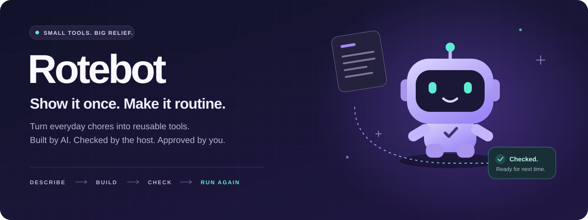
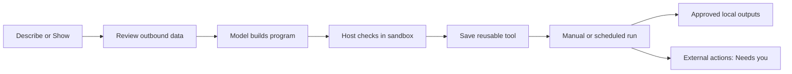

<p align="center">
  
</p>

<p align="center">
  <strong>Your next time-saving tool starts with the chore you just did.</strong><br>
  Describe it. Show it. Let Rotebot build something you can use again.
</p>

<p align="center">
  
  
  
  
</p>

<p align="center">
  <a href="#meet-rotebot">The idea</a> ·
  <a href="#from-chore-to-tool">How it works</a> ·
  <a href="#run-it-on-your-mac">Run it</a> ·
  <a href="#under-the-hood">Architecture</a> ·
  <a href="docs/build/TESTED-EXAMPLES.md">Tested examples</a>
</p>

---

## Meet Rotebot

The export you clean every Friday. The log you keep searching. The morning update you
assemble from three different places. Small jobs add up.

**Rotebot turns repetitive work into a library of small, reusable tools.** Tell it what
you need in plain language, or pick a window and **Show** it by doing the task once.
Rotebot builds a program, checks it against real data, and puts the result in front of
you for review. Save the tool. Run it again. Give that chore a shorter future.

Each tool gets its own bot character, too. Your automation library should have some personality.

| Give it a job | Get a tool for |
| --- | --- |
| “Clean up this orders export.” | Turning a repetitive CSV transformation into a reusable workflow |
| “Pull the ERROR lines out of this log.” | Extracting what matters from a text file |
| “Save Auckland's weather to a file.” | Fetching a web source and producing a readable result |
| “Summarize my calendar every morning.” | Combining approved connection reads, an optional model step, and a schedule |

CSV, log filtering, and weather have recorded runs. Connected tasks depend on service
access and setup; schedules run while the app is open. Explore the
[tested example inventory](docs/build/TESTED-EXAMPLES.md) for evidence and source-quality limits.

## From chore to tool

### 01 · Describe it. Or show it.

Type the outcome you want, or record yourself doing the chore in a selected window.
**Show** masks private details in captured frames and asks about ambiguous steps.

### 02 · Review what leaves your Mac.

See the instruction and data that would go to the model before confirming the build.
Rotebot can suggest connections when you mention a service or use it during a recording.

### 03 · Build it. Check it.

The model writes a small program; the host runs it against the selected data and checks
the result. Generated text programs are checked for deterministic output, the agreed
filename, output syntax, and any supplied example. A failed check can trigger a repair
attempt before the tool reaches you.

### 04 · Make it part of your day.

Preview the output, approve it, and save the tool for next time. Run it manually or set
a daily, weekly, or monthly schedule. Planned sends and changes to connected services
wait in **Needs you** for approval of the exact action.

## Big ambition. Explicit permissions.

The core design is simple: **AI builds the program. The host controls what it can do.**

| Boundary | What enforces it |
| --- | --- |
| Generated code runs in a sandbox | A separate QuickJS process with mandatory macOS Seatbelt isolation and memory, CPU, and wall-time limits |
| Credentials stay with the host | Approved source reads happen outside the sandbox; generated code gets data, without tokens or direct network access |
| Existing files stay intact | File commits create new files and never overwrite existing ones |
| External writes need you | Sends, posts, and service changes are staged for explicit approval |
| Scheduled work has a defined scope | Sources, optional model calls, and local outputs are approved when saving; permission changes require re-approval |
| You can see and stop activity | Run receipts, an outbound log, **Local only**, and **Emergency stop** controls |

Ordinary transformations run as programs. Tools that need summarization can include an
explicitly approved model step, with disclosed data and budgets. Scheduled local outputs
can run under their saved permissions; external writes always wait for you.

This is a **macOS developer preview**. The generated runtime is admitted for developer
builds; release admission still requires a signed immutable bundle and fresh boundary
checks. See the [runtime decision](docs/adr/0003-programs-through-runtime-v2.md) and
[build progress](docs/build/PROGRESS.md) for the current evidence.

## Built to be checked

**84 / 90 passed · 30 CSV tasks · 3 repetitions · zero forbidden effects**

That's the recorded result of a frozen Muse-plan build tested against exact expected
outputs and hidden checks. Infrastructure failures remain in the denominator. It is
evidence for that CSV family and build, rather than a general success rate for arbitrary
tasks or the current version. [Read the full evaluation →](evals/csv-family/results/2026-10-28-muse-plan-frozen-gate.md)

## Run it on your Mac

You'll need **stable Rust**, **Node 24.10+ (below 25)**, **npm 11+**, and **Xcode command-line tools**.
Run these commands from the repository root:

```sh
npm ci

# Build the native observer used by Show.
(cd native/macos-observer && swift build -c release)

# Check your local toolchain, then launch the desktop app.
bash scripts/doctor.sh
cd apps/desktop && npx tauri dev
```

Choose a route in **Settings → Model access**:

| Route | What you need | How it works |
| --- | --- | --- |
| **Meta API key** | A Meta developer API key | Enter it through a native hidden-input dialog; usage is billed to your key |
| **Muse plan** | An existing Muse login via `muse login` in Terminal | Uses your Muse allowance; requires explicit opt-in until file-access confinement is verified |
| **Offline demo** | Nothing | Builds from confirmed rules without a model; explicitly labelled as a demo, with no generated-program support |

<details>
<summary><strong>Browser preview, app bundle, and development commands</strong></summary>

Run these from the repository root.

```sh
# Explore the UI with the in-memory mock backend.
npm run -w apps/desktop dev

# Build a double-clickable Rotebot.app with the Show observer included.
bash scripts/bundle-mac.sh

# Build an optimized local bundle.
bash scripts/bundle-mac.sh --release

# Build the native binary without bundling.
(cd apps/desktop && npx tauri build --debug --no-bundle)

# Run formatting, Clippy, Rust tests, TypeScript, UI tests, and the Vite build.
bash scripts/check.sh
```

The bundle script prints the app path. Bundles use ad hoc signing for local development
and are not notarized releases.

Debug builds store secrets in `dev-secrets/secrets.json` in Rotebot's data folder
(file mode `0600`, directory mode `0700`) to avoid Keychain prompts. macOS release
builds use Keychain. `MACROSCOPE_VAULT=file|keychain` selects either store for testing.

</details>

## Under the hood



**Rust at the core. Tauri on the desktop. React at the surface.** A finite CSV
interpreter handles transformations it can express; generated JavaScript runs in the
separate QuickJS runtime. The host owns source access, checks, permissions, and commits.

| Area | Where to explore |
| --- | --- |
| Product orchestration, builds, tools, runs, and Show | [`crates/app-core`](crates/app-core) |
| CSV execution, isolated program execution, and staged commits | [`crates/executor`](crates/executor), [`crates/runner`](crates/runner), [`crates/effect-broker`](crates/effect-broker) |
| Meta Responses, Muse supervision, and program generation | [`crates/model-gateway`](crates/model-gateway), [`crates/muse-client`](crates/muse-client), [`crates/builder`](crates/builder) |
| MCP connections, OAuth with PKCE and DCR, and service detection | [`crates/connections`](crates/connections) |
| SQLCipher storage, secret stores, and outbound policy | [`crates/storage`](crates/storage), [`crates/vault`](crates/vault), [`crates/policy`](crates/policy) |
| Desktop shell, React UI, and typed backend contract | [`apps/desktop`](apps/desktop) |
| Native Show observation | [`native/macos-observer`](native/macos-observer) |

### Powered by Meta's AI tooling

| Capability | What it does in Rotebot |
| --- | --- |
| Responses API · `muse-spark-1.3` | Writes programs for the host to check |
| Structured output · `json_schema` | Returns program definitions the host can validate |
| Vision · `input_image` | Interprets masked Show recording frames |
| Built-in `web_search` | Researches API access for services mentioned in tasks |
| Image generation and editing · `muse-image-1.0` | Creates tool bot characters with a shared reference style |
| Muse plan via a custom MSP client | Offers model access through the user's Muse allowance |

For missing service access, **Send and check access** can reuse suitable connections,
research public APIs, and explain setup. Custom API connections support an approved JSON
GET with a bearer token or API-key header entered natively.
[API discovery details →](docs/adr/0006-api-discovery.md)

## A small app with a serious paper trail

Rotebot was built over several days with Claude Code and Codex writing and reviewing
most of the code. Muse Code served as an independent reviewer: its
[first](docs/build/muse-review.md) and [second](docs/build/muse-review-2.md) reviews found
16 defects, including credential-routing and secret-logging issues. Each was reproduced
with a failing test and fixed. The full commit history is in this repository.

The working name was **Macroscope**. Internal crates, binaries, and `MACROSCOPE_*`
environment variables still carry that name.

Explore the [build progress](docs/build/PROGRESS.md), [architecture decisions](docs/adr/),
[tested examples](docs/build/TESTED-EXAMPLES.md), [master plan](plan/PLAN.md),
[branch map](docs/build/BRANCHES.md), and [privacy policy](docs/legal/privacy-policy.md).

## License

Rotebot is licensed under the [GNU Affero General Public License v3.0 only](LICENSE)
(`AGPL-3.0-only`).

---

<p align="center"><strong>Show it once. Make it routine.</strong></p>
